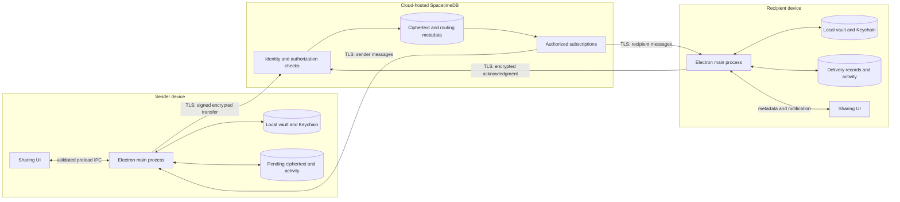
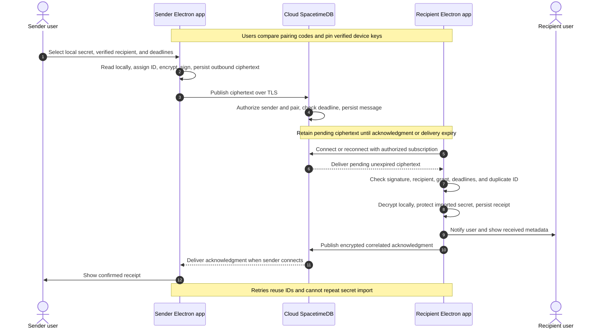

# .sct architecture and implementation order

## Architecture

The local app foundation exists.
Issue #32 adds runtime injection without .env or replacement files in the project folder before relay setup.
The relay and local Agent Access branches then proceed independently.
Only integration issue #33 requires both branches.
See [runtime injection](runtime-injection.md) for project resolution and loader compatibility.

.sct uses Electron, React, and TypeScript. The Electron main process owns sensitive operations on each device.
Cloud-hosted SpacetimeDB persists encrypted handoffs and exposes authorized subscriptions.
Devices retain local vaults, cached activity, pending messages, and durable execution records.
Separate local SpacetimeDB servers are no longer required.

## Local runtime injection

The project registry maps a project to its source folder.
The configured external vault root resolves .sct/[project-name]/secrets.sct.
Issue #32 decrypts locally and supplies the child environment before the project command starts.
The project folder needs no .env, replacement secret file, .sct manifest, symlink, or FIFO.
Local launches work offline and do not depend on agent or relay issues.
The launched program and its descendants can read or copy their environment.
The CLI selects projects from the current folder and restarts the command when saved keys change.
The dependency-free TypeScript SDK loads values through a signed helper's private process pipes.
It updates the calling application's `process.env` without restarting that application.
Library clients that retain keys require recreation through the SDK's `onChange` callback.
Both paths check encrypted file revisions locally and resolve registry and storage changes before reading values.
Neither path adds a local server, relay dependency, or project-local secret file.

## Phase 2 architecture

The Electron main process owns vault access, device keys, encryption, relay connections, and local grant cleanup.
The renderer uses a narrow preload bridge and receives metadata only.
Devices retain local vaults, cached activity, pending ciphertext, and durable delivery records.
SpacetimeDB stores ciphertext and minimal routing metadata.
Neither device requires a local SpacetimeDB server or a separate application daemon.

## Phase 2 sharing sequence

Receipt confirms durable delivery. It does not confirm execution.
No step launches a process or requires an agent.

## Standalone Agent Access

Reuse #32 for local project resolution and environment injection.
Issues #5, #7, #4, #18, #8, #9, and #10 add local requests, approval, execution, and MCP.
Their contracts contain no relay identities, paired recipients, or wire envelopes.
Issue #18 enforces local project access before #8 launches the fixed approved task.
Issue #33 later maps remote tasks and received grants onto this local path.
Claude Code's own model service can require internet access independently of the relay.

Issue #8 provides local approval and execution states where needed.
Issue #9 exposes list_secrets, describe_secret, and run_demo only.
Issue #10 checks local Claude integration, refusal, deadlines, and reused approvals.
Keep plaintext values outside command arguments, logs, renderer responses, and MCP results.

## Storage and authorization

The local vault keeps encrypted project files and protects their keys in macOS Keychain.
Device private keys and relay client tokens stay under local Keychain protection.
The renderer never receives stored secret values, private keys, or relay tokens.
It clears entered values after submission.
Relay deployment credentials stay outside Git and desktop builds.

The TypeScript relay module defines authenticated devices, verified pairs, encrypted envelopes, grants, and delivery status.
Issue #11 defines the schema and communication contract.
Issue #16 defines shared transfer and acknowledgment types.
Use shared TypeScript types where the relay and clients require the same contract.

Each envelope carries an ID, sender, recipient, kind, correlation ID, delivery deadline, nonce, signature, and ciphertext.
Keep secrets, grant contents, and descriptive secret names inside ciphertext.
Authenticate routing fields with the ciphertext.
The planned device keys use X25519 for encryption and Ed25519 for signatures.

Use TLS for every relay connection.
Bind each device to an authenticated relay identity.
Both users verify device keys before sharing.
A relay identity alone does not establish trust in a public key.
Require new verification after a peer key changes.

Check that the claimed sender matches the authenticated caller.
Authorize pair registration, publication, reads, subscriptions, and status changes.
An acknowledgment must come from the expected recipient.
Use private tables with authorized views, or equivalent server enforcement.
Client subscription filters alone do not enforce authorization.
Check delivery deadlines against server time.

## Phase 2 delivery and expiry rules

1. Persist outbound ciphertext locally before publication.
2. Persist accepted ciphertext on the relay before confirming publication.
3. Restore authorized subscriptions and pending delivery after reconnect.
4. Retry with bounded backoff and the original message ID.
5. Reject an ID reused with different contents.
6. Check the signature, verified sender, recipient, grant, and deadlines before local import.
7. Protect the received secret locally and persist receipt before sending an acknowledgment.
8. Return existing receipt status for duplicate delivery without another secret import.
9. Persist acknowledgments for offline senders.
10. Retain duplicate-delivery records through the replay window.

Give transfers, acknowledgments, and status replies explicit retention deadlines.
Never retry expired ciphertext under a new ID without a new user submission.
The sharing UI distinguishes queued, sent, received, failed, and expired states.
Issue #14 defines the controls and activity view.
Issue #17 connects those controls to actual relay delivery.
Issue #14 does not depend on #17.
Issue #20 checks the connected flow.

Delivery expiry blocks later import of that message.
It cannot revoke credentials already delivered.
Grant expiry separately blocks new local access.
Received injection-only grants deny reveal, copy, and reshare from the time of import.
These restrictions belong to Phase 2 and do not depend on agent approval.

Check grant expiry before import and access, at startup, after resume, and during scheduled cleanup.
Remove expired recipient Keychain entries and applicable encrypted files.
Persist cleanup outcomes and queue an encrypted expiry notification for the sender.
Cleanup cannot run while the app is closed or the device is asleep.
Cleanup must finish before new access after startup or resume.
External copies can retain delivered credentials.

## Offline behavior

Local vault operations remain available during relay outages.
Persist pending transfers, replies, grant deadlines, delivery records, and cached activity locally.
The UI identifies cached status separately from confirmed remote status.
Cross-device delivery and acknowledgments require the relay.
Local expiry checks do not depend on a live subscription.

## Integration of sharing and Agent Access

Issue #33 starts after secure sharing in #20 and local Agent Access in #10 pass.
It extends #16 envelopes and #17 delivery for encrypted task requests, refusals, and execution results.
The standalone local request contracts remain independent of relay identities and wire envelopes.

Require local recipient approval tied to the task, grant, recipient, and message ID.
Check the permitted operation, active grant, and deadline immediately before launch.
A relay message or agent cannot approve its own execution.
Reject arbitrary commands and reused approval responses.
Reuse the approved local launch path from #8 and runtime injection from #32.

Persist an execution claim before launch.
Persist outcomes and encrypted, signed, correlated replies for offline senders.
Return approved, redacted results only.
Keep secrets, task contents, and execution output inside ciphertext.
Do not relay unrestricted agent logs.

Durable execution records prevent duplicate delivery from automatically repeating execution.
A claim without a durable outcome after a crash requires local review before another launch.
Retain execution records through the replay window.
Do not promise exactly-once execution of arbitrary process side effects.
An expired grant blocks new launches but cannot remove credentials from an already-running process.

Add remote approval and execution states under #33.
Keep receipt distinct from awaiting approval, running, completed, refused, expired, and uncertain execution.
Check crash recovery, duplicate execution, and offline result return during integration.
Local Agent Access remains usable without the relay.
Basic sharing remains usable without an agent.

## Implementation order

Complete local runtime injection before relay setup.
Then develop the relay and local Agent Access branches independently.
Only #33 combines their prerequisites.

GitHub issue IDs stay unchanged.
Title prefixes define a valid topological order.
A ticket starts when its listed prerequisites pass.
Numeric branch order does not block independent work.

### Local foundation

| Order | Issue | Work | Prerequisites |
|---|---|---|---|
| 1.1 | [#24](https://github.com/omavashia2005/.sct/issues/24) | Bootstrap the Electron, React, and TypeScript app | None |
| 1.2 | [#1](https://github.com/omavashia2005/.sct/issues/1) | Create a stable Electron app signing identity | #24 |
| 1.3 | [#25](https://github.com/omavashia2005/.sct/issues/25) | Build the basic Secrets screen | #24 |
| 1.4 | [#26](https://github.com/omavashia2005/.sct/issues/26) | Connect the Secrets screen to macOS Keychain | #24, #1, #25 |
| 1.5 | [#2](https://github.com/omavashia2005/.sct/issues/2) | Test Keychain access after Electron rebuild | #1, #26 |
| 1.6 | [#6](https://github.com/omavashia2005/.sct/issues/6) | Check the local vault operations for sharing | #2, #26 |
| 1.7 | [#32](https://github.com/omavashia2005/.sct/issues/32) | Inject project secrets at runtime without .env files | #6, #26 |

### Relay setup and contracts

| Order | Issue | Work | Prerequisites |
|---|---|---|---|
| 2.1.1 | [#3](https://github.com/omavashia2005/.sct/issues/3) | Set up the cloud-hosted SpacetimeDB relay | #32 |
| 2.1.2 | [#11](https://github.com/omavashia2005/.sct/issues/11) | Define the relay schema and communication contract | #3 |
| 2.1.3 | [#12](https://github.com/omavashia2005/.sct/issues/12) | Connect Electron storage to the SpacetimeDB relay | #6, #11 |
| 2.1.4 | [#15](https://github.com/omavashia2005/.sct/issues/15) | Verify pairing and bind device keys to relay identities | #6, #11, #12 |
| 2.1.5 | [#16](https://github.com/omavashia2005/.sct/issues/16) | Define encrypted secret transfer and acknowledgment envelopes | #11, #15 |
| 2.1.6 | [#13](https://github.com/omavashia2005/.sct/issues/13) | Secure the sharing operations across the Electron boundary | #12 |

### Sharing UI, delivery, and security checks

| Order | Issue | Work | Prerequisites |
|---|---|---|---|
| 2.2.1 | [#14](https://github.com/omavashia2005/.sct/issues/14) | Build the secret sharing and delivery activity UI | #13, #15, #16 |
| 2.2.2 | [#17](https://github.com/omavashia2005/.sct/issues/17) | Deliver secrets and acknowledgments through SpacetimeDB | #3, #11, #12, #15, #16, #13, #14 |
| 2.2.3 | [#19](https://github.com/omavashia2005/.sct/issues/19) | Handle sharing expiry, local cleanup, and retry deadlines | #17 |
| 2.2.4 | [#20](https://github.com/omavashia2005/.sct/issues/20) | Check secure secret sharing on two devices | #17, #19 |

Build #14 with delivery work in #17 so users can test transfers from the app.
The UI contract precedes the delivery connection.
Issue #14 does not depend on #17.

### Independent local Agent Access

| Order | Issue | Work | Prerequisites |
|---|---|---|---|
| 3.1 | [#5](https://github.com/omavashia2005/.sct/issues/5) | Add the TypeScript agent CLI, MCP entrypoint, and demo build commands | #32, #24, #1 |
| 3.2 | [#7](https://github.com/omavashia2005/.sct/issues/7) | Define local agent requests and the authenticated request channel | #5, #6, #32 |
| 3.3 | [#4](https://github.com/omavashia2005/.sct/issues/4) | Check Claude Code MCP approval | #5, #24 |
| 3.4 | [#18](https://github.com/omavashia2005/.sct/issues/18) | Enforce local project access and agent approval | #7, #32 |
| 3.5 | [#8](https://github.com/omavashia2005/.sct/issues/8) | Launch approved local agents with project environment injection | #7, #18, #32 |
| 3.6 | [#9](https://github.com/omavashia2005/.sct/issues/9) | Implement the narrow MCP interface | #4, #8 |
| 3.7 | [#10](https://github.com/omavashia2005/.sct/issues/10) | Connect Claude Code and check local Agent Access | #9, #24 |

These issues have no direct or indirect dependency on a relay issue.
They use local vault operations and #32 runtime injection.
They can finish without relay configuration, pairing, or #20.

### Integration

| Order | Issue | Work | Prerequisites |
|---|---|---|---|
| 3.8 | [#33](https://github.com/omavashia2005/.sct/issues/33) | Integrate local Agent Access with encrypted relay sharing | #20, #10, #16, #17, #19 |

Issue #33 adds remote grant validation, task envelopes, execution records, encrypted replies, and remote activity states.
Check crash recovery, duplicate execution, and offline result return here.
Local agents remain independent of relay availability.
Basic sharing remains independent of agents.

### Post-MVP and maintenance

| Order | Issue | Work | Prerequisites |
|---|---|---|---|
| 4.1 | [#22](https://github.com/omavashia2005/.sct/issues/22) | Add AirDrop transport for encrypted handoffs | #20, #15, #16, #18 |
| 4.2 | [#23](https://github.com/omavashia2005/.sct/issues/23) | Add Factory integration through the narrow MCP interface | #10, #9, #18 |

Issue #30 is separate workflow maintenance.
Issue #21 remains closed because demo rehearsal is outside development scope.

## Checks

Use existing checks during implementation.
Run Playwright UI checks and React Doctor after each UI change.
Run the repository lint and type checks.
Follow AGENTS.md approval requirements before adding new tests.
Check sharing independently in #20 and local Agent Access independently in #10.
Check their integration in #33.

## Reference documentation

SpacetimeDB supports TypeScript modules and clients.
Its access controls distinguish public tables, private tables, and authorized views.
Consult the [module documentation](https://spacetimedb.com/docs/databases/), [tables](https://spacetimedb.com/docs/tables/), and [views](https://spacetimedb.com/docs/functions/views/) during implementation.
