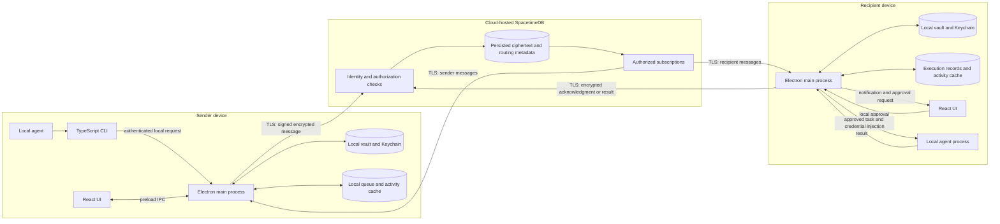
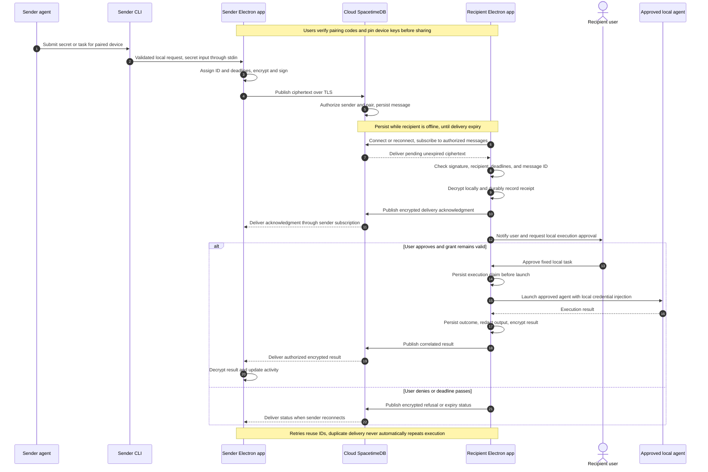

# .sct architecture and implementation order

## Architecture

The local app foundation exists.
Issue #32 adds runtime injection without .env or replacement files in the project folder before relay setup.
The relay and local Agent Access branches then proceed independently.
Only integration issue #33 requires both branches.
See [runtime injection](runtime-injection.md) for project resolution and loader compatibility.

.sct uses Electron, React, and TypeScript. The Electron main process owns sensitive operations on each device.
Cloud-hosted SpacetimeDB persists encrypted handoffs and exposes authorized subscriptions.
Devices retain local vaults, cached activity, pending messages, and durable execution records.
Separate local SpacetimeDB servers are no longer required.

The following diagram shows the planned integrated flow in #33.
Standalone sharing starts at the React UI and uses no agent or CLI submission.
Standalone Agent Access uses the local vault and runner without relay connections.

## Integrated handoff sequence

## Local runtime injection

The project registry maps a project to its source folder.
The configured external vault root resolves .sct/[project-name]/secrets.sct.
Issue #32 decrypts locally and supplies the child environment before the project command starts.
The project folder needs no .env, replacement secret file, .sct manifest, symlink, or FIFO.
Local launches work offline and do not depend on agent or relay issues.
The launched program and its descendants can read or copy their environment.

## Standalone secret sharing

1. Both users verify their device keys in the app.
2. The sender selects a local secret, verified recipient, and deadlines.
3. The sender encrypts, signs, and persists outbound ciphertext locally.
4. The relay authorizes and persists the transfer.
5. The recipient validates and imports the secret, then persists receipt.
6. An encrypted acknowledgment returns and both apps show delivery status.

Use durable receipt records to prevent duplicate secret imports.
Enforce received grant restrictions and expiry during import and local cleanup.
No sharing step requires an agent, MCP, or agent approval.
Build the sharing UI with delivery under #14 and #17.

## Standalone Agent Access

Reuse #32 for local project resolution and environment injection.
Issues #5, #7, #4, #18, #8, #9, and #10 add local requests, approval, execution, and MCP.
Their contracts contain no relay identities, paired recipients, or wire envelopes.
Issue #18 enforces local project access before #8 launches the fixed approved task.
Issue #33 later maps remote tasks and received grants onto this local path.
Claude Code's own model service can require internet access independently of the relay.

## Storage and authorization

The local vault keeps credential values and private keys under Keychain protection.
Any local secret files contain ciphertext only. Grant cleanup removes applicable Keychain entries and encrypted files.
The renderer receives metadata and approval prompts. It clears entered secret values after the initial save request.
The agent CLI submits secrets through stdin or a local vault reference. Secret input must not enter process arguments or logs.

The TypeScript relay module defines device identities, verified pair bindings, message envelopes, grants, and delivery status.
Standalone sharing uses secret transfers and acknowledgments.
Issue #33 extends those contracts for tasks and execution results.
Each envelope carries an ID, sender, recipient, kind, correlation ID, delivery deadline, nonce, signature, and ciphertext.
Task contents, secrets, and execution output stay inside ciphertext. Avoid descriptive secret names in routing metadata.
Private keys remain on devices. Relay deployment credentials stay outside desktop builds.

Use TLS for all relay connections. Bind each device to an authenticated relay identity.
Require verified pairing before accepting a handoff. Check that the claimed sender matches the authenticated caller.
Authorize reads, subscriptions, and status changes. An acknowledgment or result must come from the expected recipient.
Use private tables with authorized views, or equivalent server-enforced restrictions.
Client subscription filters alone do not enforce authorization.
Check delivery deadlines against server time. Authenticate routing fields together with the ciphertext.

## Delivery and execution rules

Rules 1–4 apply to sharing.
Rules 5–8 describe the integrated remote execution in #33.
Standalone local agents do not wait for relay delivery.

1. Persist outbound ciphertext locally before publication. The relay persists accepted ciphertext before confirming submission.
2. Replay pending messages through subscriptions after reconnect. Keep eligible data until acknowledgment or delivery expiry.
3. Retry with bounded backoff and the original message ID. Reject an ID reused with different contents.
4. Persist receipt before sending a delivery acknowledgment. Receipt confirms delivery, not execution success.
5. Check deadlines and grant permissions immediately before execution. Require recipient approval for the fixed task.
6. Persist an execution claim before process launch. Persist outcomes and queue return messages for retry.
7. Treat a claim without a durable outcome as uncertain after a crash. Require local review before another launch.
8. Retain duplicate-protection records through the replay window. Do not promise exactly-once execution of arbitrary process side effects.

Delivery, acknowledgment, and result messages each have explicit retention deadlines.
Show expired status. Never retry an expired payload under a new ID without a new submission.
Replies use authenticated encryption for the original sender and include the original correlation ID.
Return only approved, redacted results. Do not relay unrestricted agent logs.

Message expiry prevents later delivery or execution of that message. It cannot revoke credentials already delivered.
Grant expiry separately blocks future vault access.
Scheduled local checks remove expired grant material and queue an expiry notification for the sender.
Run checks at startup, after resume, and before use.
An app timer cannot delete files while the app is closed or the device is asleep.
Cleanup removes expired material before new use. Running processes and external copies can retain credentials.

## Offline behavior

Local vault operations and authorized local launches work without the relay.
Persist pending submissions, replies, execution claims, grant deadlines, and activity locally.
The UI distinguishes cached information from confirmed remote status.
Cross-device delivery requires a relay connection. Local expiry checks never depend on a live subscription.

## Implementation order

Complete local runtime injection before relay setup.
Then develop the relay and local Agent Access branches independently.
Only #33 combines their prerequisites.

GitHub issue IDs stay unchanged.
Title prefixes define a valid topological order.
A ticket starts when its listed prerequisites pass.
Numeric branch order does not block independent work.

### Local foundation

| Order | Issue | Work | Prerequisites |
|---|---|---|---|
| 1.1 | [#24](https://github.com/omavashia2005/.sct/issues/24) | Bootstrap the Electron, React, and TypeScript app | None |
| 1.2 | [#1](https://github.com/omavashia2005/.sct/issues/1) | Create a stable Electron app signing identity | #24 |
| 1.3 | [#25](https://github.com/omavashia2005/.sct/issues/25) | Build the basic Secrets screen | #24 |
| 1.4 | [#26](https://github.com/omavashia2005/.sct/issues/26) | Connect the Secrets screen to macOS Keychain | #24, #1, #25 |
| 1.5 | [#2](https://github.com/omavashia2005/.sct/issues/2) | Test Keychain access after Electron rebuild | #1, #26 |
| 1.6 | [#6](https://github.com/omavashia2005/.sct/issues/6) | Check the local vault operations for sharing | #2, #26 |
| 1.7 | [#32](https://github.com/omavashia2005/.sct/issues/32) | Inject project secrets at runtime without .env files | #6, #26 |

### Relay setup and contracts

| Order | Issue | Work | Prerequisites |
|---|---|---|---|
| 2.1.1 | [#3](https://github.com/omavashia2005/.sct/issues/3) | Set up the cloud-hosted SpacetimeDB relay | #32 |
| 2.1.2 | [#11](https://github.com/omavashia2005/.sct/issues/11) | Define the relay schema and communication contract | #3 |
| 2.1.3 | [#12](https://github.com/omavashia2005/.sct/issues/12) | Connect Electron storage to the SpacetimeDB relay | #6, #11 |
| 2.1.4 | [#15](https://github.com/omavashia2005/.sct/issues/15) | Verify pairing and bind device keys to relay identities | #6, #11, #12 |
| 2.1.5 | [#16](https://github.com/omavashia2005/.sct/issues/16) | Define encrypted secret transfer and acknowledgment envelopes | #11, #15 |
| 2.1.6 | [#13](https://github.com/omavashia2005/.sct/issues/13) | Secure the sharing operations across the Electron boundary | #12 |

### Sharing UI, delivery, and security checks

| Order | Issue | Work | Prerequisites |
|---|---|---|---|
| 2.2.1 | [#14](https://github.com/omavashia2005/.sct/issues/14) | Build the secret sharing and delivery activity UI | #13, #15, #16 |
| 2.2.2 | [#17](https://github.com/omavashia2005/.sct/issues/17) | Deliver secrets and acknowledgments through SpacetimeDB | #3, #11, #12, #15, #16, #13, #14 |
| 2.2.3 | [#19](https://github.com/omavashia2005/.sct/issues/19) | Handle sharing expiry, local cleanup, and retry deadlines | #17 |
| 2.2.4 | [#20](https://github.com/omavashia2005/.sct/issues/20) | Check secure secret sharing on two devices | #17, #19 |

Build #14 with delivery work in #17 so users can test transfers from the app.
The UI contract precedes the delivery connection.
Issue #14 does not depend on #17.

### Independent local Agent Access

| Order | Issue | Work | Prerequisites |
|---|---|---|---|
| 3.1 | [#5](https://github.com/omavashia2005/.sct/issues/5) | Add the TypeScript agent CLI, MCP entrypoint, and demo build commands | #32, #24, #1 |
| 3.2 | [#7](https://github.com/omavashia2005/.sct/issues/7) | Define local agent requests and the authenticated request channel | #5, #6, #32 |
| 3.3 | [#4](https://github.com/omavashia2005/.sct/issues/4) | Check Claude Code MCP approval | #5, #24 |
| 3.4 | [#18](https://github.com/omavashia2005/.sct/issues/18) | Enforce local project access and agent approval | #7, #32 |
| 3.5 | [#8](https://github.com/omavashia2005/.sct/issues/8) | Launch approved local agents with project environment injection | #7, #18, #32 |
| 3.6 | [#9](https://github.com/omavashia2005/.sct/issues/9) | Implement the narrow MCP interface | #4, #8 |
| 3.7 | [#10](https://github.com/omavashia2005/.sct/issues/10) | Connect Claude Code and check local Agent Access | #9, #24 |

These issues have no direct or indirect dependency on a relay issue.
They use local vault operations and #32 runtime injection.
They can finish without relay configuration, pairing, or #20.

### Integration

| Order | Issue | Work | Prerequisites |
|---|---|---|---|
| 3.8 | [#33](https://github.com/omavashia2005/.sct/issues/33) | Integrate local Agent Access with encrypted relay sharing | #20, #10, #16, #17, #19 |

Issue #33 adds remote grant validation, task envelopes, execution records, encrypted replies, and remote activity states.
Check crash recovery, duplicate execution, and offline result return here.
Local agents remain independent of relay availability.
Basic sharing remains independent of agents.

### Post-MVP and maintenance

| Order | Issue | Work | Prerequisites |
|---|---|---|---|
| 4.1 | [#22](https://github.com/omavashia2005/.sct/issues/22) | Add AirDrop transport for encrypted handoffs | #20, #15, #16, #18 |
| 4.2 | [#23](https://github.com/omavashia2005/.sct/issues/23) | Add Factory integration through the narrow MCP interface | #10, #9, #18 |

Issue #30 is separate workflow maintenance.
Issue #21 remains closed because demo rehearsal is outside development scope.

## Reference documentation

SpacetimeDB supports TypeScript modules and clients.
Its access controls distinguish public tables, private tables, and authorized views.
Consult the [module documentation](https://spacetimedb.com/docs/databases/), [tables](https://spacetimedb.com/docs/tables/), and [views](https://spacetimedb.com/docs/functions/views/) during implementation.
