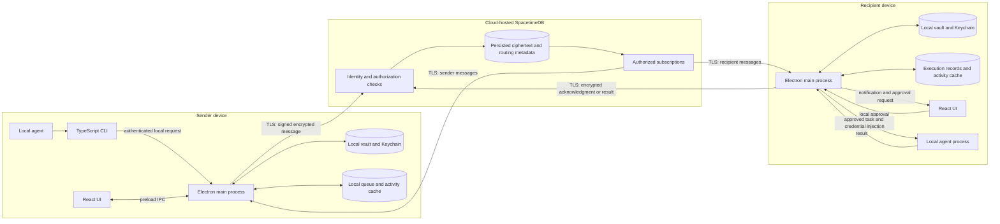
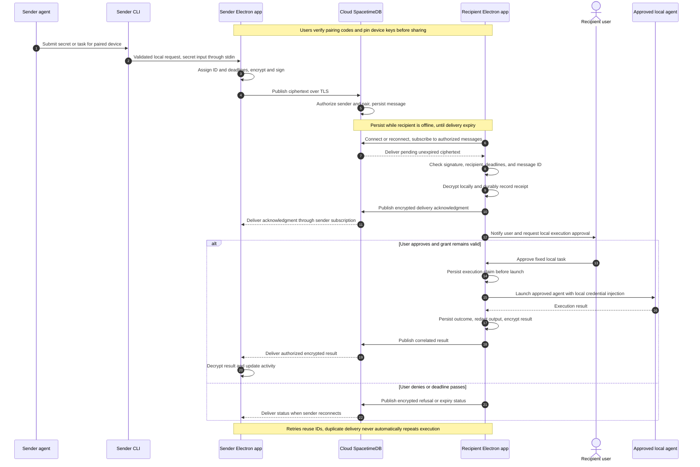

# .sct architecture and implementation order

## Architecture

.sct uses Electron, React, and TypeScript. The Electron main process owns sensitive operations on each device.
Cloud-hosted SpacetimeDB persists encrypted handoffs and exposes authorized subscriptions.
Devices retain local vaults, cached activity, pending messages, and durable execution records.
Separate local SpacetimeDB servers are no longer required.

## Handoff sequence

## Storage and authorization

The local vault keeps credential values and private keys under Keychain protection.
Any local secret files contain ciphertext only. Grant cleanup removes applicable Keychain entries and encrypted files.
The renderer receives metadata and approval prompts. It clears entered secret values after the initial save request.
The CLI submits secrets through stdin or a local vault reference. Secret input must not enter process arguments or logs.

The TypeScript relay module defines device identities, verified pair bindings, message envelopes, grants, and delivery status.
Each envelope carries an ID, sender, recipient, kind, correlation ID, delivery deadline, nonce, signature, and ciphertext.
Task contents, secrets, and execution output stay inside ciphertext. Avoid descriptive secret names in routing metadata.
Private keys remain on devices. Relay deployment credentials stay outside desktop builds.

Use TLS for all relay connections. Bind each device to an authenticated relay identity.
Require verified pairing before accepting a handoff. Check that the claimed sender matches the authenticated caller.
Authorize reads, subscriptions, and status changes. An acknowledgment or result must come from the expected recipient.
Use private tables with authorized views, or equivalent server-enforced restrictions.
Client subscription filters alone do not enforce authorization.
Check delivery deadlines against server time. Authenticate routing fields together with the ciphertext.

## Delivery and execution rules

1. Persist outbound ciphertext locally before publication. The relay persists accepted ciphertext before confirming submission.
2. Replay pending messages through subscriptions after reconnect. Keep eligible data until acknowledgment or delivery expiry.
3. Retry with bounded backoff and the original message ID. Reject an ID reused with different contents.
4. Persist receipt before sending a delivery acknowledgment. Receipt confirms delivery, not execution success.
5. Check deadlines and grant permissions immediately before execution. Require recipient approval for the fixed task.
6. Persist an execution claim before process launch. Persist outcomes and queue return messages for retry.
7. Treat a claim without a durable outcome as uncertain after a crash. Require local review before another launch.
8. Retain duplicate-protection records through the replay window. Do not promise exactly-once execution of arbitrary process side effects.

Delivery, acknowledgment, and result messages each have explicit retention deadlines.
Show expired status. Never retry an expired payload under a new ID without a new submission.
Replies use authenticated encryption for the original sender and include the original correlation ID.
Return only approved, redacted results. Do not relay unrestricted agent logs.

Message expiry prevents later delivery or execution of that message. It cannot revoke credentials already delivered.
Grant expiry separately blocks future vault access.
Scheduled local checks remove expired grant material and queue an expiry notification for the sender.
Run checks at startup, after resume, and before use.
An app timer cannot delete files while the app is closed or the device is asleep.
Cleanup removes expired material before new use. Running processes and external copies can retain credentials.

## Offline behavior

Local vault operations and authorized local launches work without the relay.
Persist pending submissions, replies, execution claims, grant deadlines, and activity locally.
The UI distinguishes cached information from confirmed remote status.
Cross-device delivery requires a relay connection. Local expiry checks never depend on a live subscription.

## Implementation order

Issue numbers are stable identifiers. These waves define the order.
A ticket starts after all listed prerequisites pass. Existing assignments and collaboration instructions remain in their tickets.

| Wave | Issues | Result |
|---|---|---|
| 1 | #24, #3 | Electron/React foundation and cloud relay setup |
| 2 | #1, #25, #4, #11 | App signing, Secrets screen, MCP spike, authorized relay schema |
| 3 | #26, #5 | Keychain bridge and TypeScript CLI/build entrypoints |
| 4 | #2 | Keychain rebuild check |
| 5 | #6 | Local vault operations |
| 6 | #7, #12, #15 | CLI contract, main-process storage, verified pairing |
| 7 | #8, #13, #16 | Approved launch, Electron security, encrypted envelopes |
| 8 | #9, #18 | Narrow MCP tools and local access controls |
| 9 | #10, #17 | Claude integration and relay handoff loop |
| 10 | #14, #19 | Activity UI and expiry/retry lifecycle |
| 11 | #20 | Offline, authorization, and delivery acceptance tests |

Dependencies:

- #24 → #1, #25, #4. #3 → #11.
- #24 + #25 + #1 → #26. #24 + #1 → #5.
- #1 + #26 → #2. #2 + #5 → #6.
- #6 → #7. #6 + #11 → #12. #6 + #11 → #15.
- #7 + #12 → #8. #12 → #13. #7 + #15 → #16.
- #4 + #8 → #9. #8 + #16 → #18.
- #9 + #13 → #10. #11 + #12 + #13 + #15 + #16 + #18 → #17.
- #17 → #14. #17 + #18 → #19.
- #10 + #14 + #19 → #20.

Post-MVP: #22 covers AirDrop and #23 covers Factory.
Issue #21 remains closed because demo rehearsal is outside development scope.

## Reference documentation

SpacetimeDB supports TypeScript modules and clients.
Its access controls distinguish public tables, private tables, and authorized views.
Consult the [module documentation](https://spacetimedb.com/docs/databases/), [tables](https://spacetimedb.com/docs/tables/), and [views](https://spacetimedb.com/docs/functions/views/) during implementation.
