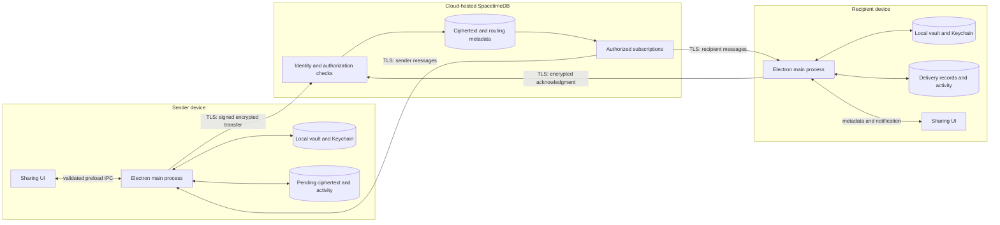
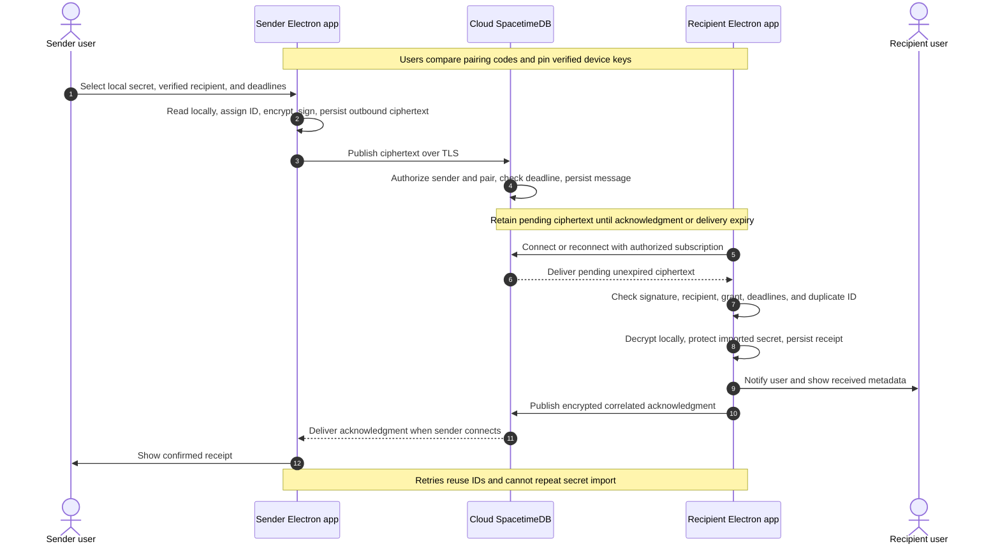

# .sct architecture and implementation order

## Current scope

The local Electron, React, and TypeScript app exists.
Phase 2 adds secure secret sharing between two desktop apps through cloud-hosted SpacetimeDB.
Phase 3 adds Agent Access only after the Phase 2 acceptance checkpoint in #20.

Phase 2 requires no CLI, MCP server, installed agent, task launch, or agent approval.
Build the sharing UI with delivery so users can test transfers directly from both app windows.
Unchecked issue criteria describe planned behavior.

## Phase 2 architecture

The Electron main process owns vault access, device keys, encryption, relay connections, and local grant cleanup.
The renderer uses a narrow preload bridge and receives metadata only.
Devices retain local vaults, cached activity, pending ciphertext, and durable delivery records.
SpacetimeDB stores ciphertext and minimal routing metadata.
Neither device requires a local SpacetimeDB server or a separate application daemon.

## Phase 2 sharing sequence

Receipt confirms durable delivery. It does not confirm execution.
No step launches a process or requires an agent.

## Storage and authorization

The local vault keeps encrypted project files and protects their keys in macOS Keychain.
Device private keys and relay client tokens stay under local Keychain protection.
The renderer never receives stored secret values, private keys, or relay tokens.
It clears entered values after submission.
Relay deployment credentials stay outside Git and desktop builds.

The TypeScript relay module defines authenticated devices, verified pairs, encrypted envelopes, grants, and delivery status.
Issue #11 defines the schema and communication contract.
Issue #16 defines shared transfer and acknowledgment types.
Use shared TypeScript types where the relay and clients require the same contract.

Each envelope carries an ID, sender, recipient, kind, correlation ID, delivery deadline, nonce, signature, and ciphertext.
Keep secrets, grant contents, and descriptive secret names inside ciphertext.
Authenticate routing fields with the ciphertext.
The planned device keys use X25519 for encryption and Ed25519 for signatures.

Use TLS for every relay connection.
Bind each device to an authenticated relay identity.
Both users verify device keys before sharing.
A relay identity alone does not establish trust in a public key.
Require new verification after a peer key changes.

Check that the claimed sender matches the authenticated caller.
Authorize pair registration, publication, reads, subscriptions, and status changes.
An acknowledgment must come from the expected recipient.
Use private tables with authorized views, or equivalent server enforcement.
Client subscription filters alone do not enforce authorization.
Check delivery deadlines against server time.

## Phase 2 delivery and expiry rules

1. Persist outbound ciphertext locally before publication.
2. Persist accepted ciphertext on the relay before confirming publication.
3. Restore authorized subscriptions and pending delivery after reconnect.
4. Retry with bounded backoff and the original message ID.
5. Reject an ID reused with different contents.
6. Check the signature, verified sender, recipient, grant, and deadlines before local import.
7. Protect the received secret locally and persist receipt before sending an acknowledgment.
8. Return existing receipt status for duplicate delivery without another secret import.
9. Persist acknowledgments for offline senders.
10. Retain duplicate-delivery records through the replay window.

Give transfers, acknowledgments, and status replies explicit retention deadlines.
Never retry expired ciphertext under a new ID without a new user submission.
The sharing UI distinguishes queued, sent, received, failed, and expired states.
Issue #14 defines the controls and activity view.
Issue #17 connects those controls to actual relay delivery.
Issue #14 does not depend on #17.
Issue #20 checks the connected flow.

Delivery expiry blocks later import of that message.
It cannot revoke credentials already delivered.
Grant expiry separately blocks new local access.
Received injection-only grants deny reveal, copy, and reshare from the time of import.
These restrictions belong to Phase 2 and do not depend on agent approval.

Check grant expiry before import and access, at startup, after resume, and during scheduled cleanup.
Remove expired recipient Keychain entries and applicable encrypted files.
Persist cleanup outcomes and queue an encrypted expiry notification for the sender.
Cleanup cannot run while the app is closed or the device is asleep.
Cleanup must finish before new access after startup or resume.
External copies can retain delivered credentials.

## Offline behavior

Local vault operations remain available during relay outages.
Persist pending transfers, replies, grant deadlines, delivery records, and cached activity locally.
The UI identifies cached status separately from confirmed remote status.
Cross-device delivery and acknowledgments require the relay.
Local expiry checks do not depend on a live subscription.

## Phase 3 Agent Access

Start this work only after #20 passes.
Reuse the completed sharing transport and its security checks.

Issues #5 and #7 add TypeScript CLI and MCP entrypoints, validated agent requests, and a restricted local channel to Electron.
Secrets enter through stdin or a local vault reference.
Keep secrets outside process arguments, logs, and responses.
Extend the envelope contract for encrypted tasks and execution replies in Phase 3.

Issue #4 checks Claude Code MCP approval.
Issue #18 adds local approval tied to the fixed task, grant, and message ID.
Recheck the recipient, permitted operation, active grant, and deadline immediately before launch.
A relay message or agent cannot approve its own execution.
Reject arbitrary commands and reused approval responses.

Issue #8 launches only the approved executable and fixed demo task.
Inject credentials through the child environment without a plaintext .env file.
Persist an execution claim before launch.
Persist outcomes and encrypted, signed, correlated replies for offline senders.
Return approved, redacted results only.
Keep secrets, task contents, and execution output inside ciphertext.
Do not relay unrestricted agent logs.

Durable execution records prevent duplicate delivery from automatically repeating execution.
A claim without a durable outcome after a crash requires local review before another launch.
Retain execution records through the replay window.
Do not promise exactly-once execution of arbitrary process side effects.
An expired grant blocks new launches but cannot remove credentials from an already-running process.

Issue #8 also adds approval and execution states to the existing activity UI.
Keep receipt distinct from awaiting approval, running, completed, refused, expired, and uncertain execution.
Issue #9 exposes list_secrets, describe_secret, and run_demo only.
Issue #10 checks Claude integration, execution approval, replay protection, crash recovery, and encrypted result return.
Phase 2 sharing remains usable without these components.

## Implementation order

GitHub issue IDs are stable identifiers.
Numbered title prefixes define the implementation order.
Read each numeric segment in order.
Every prerequisite appears earlier than its dependent issue.
Issues can proceed together when their listed prerequisites pass.

The tables below and the GitHub issue descriptions use the same dependency list.
Phase 2 has no dependency on Phase 3.
Every Phase 3 issue explicitly depends on #20.
Existing issue states, owners, and labels remain unchanged.
The basic app exists, but #6 remains an open check of the local vault operations.

### Phase 1: Local app foundation

| Order | Issue | Work | Prerequisites |
|---|---|---|---|
| 1.1 | [#24](https://github.com/omavashia2005/.sct/issues/24) | Bootstrap the Electron, React, and TypeScript app | None |
| 1.2 | [#1](https://github.com/omavashia2005/.sct/issues/1) | Create a stable Electron app signing identity | [#24](https://github.com/omavashia2005/.sct/issues/24) |
| 1.3 | [#25](https://github.com/omavashia2005/.sct/issues/25) | Build the basic Secrets screen | [#24](https://github.com/omavashia2005/.sct/issues/24) |
| 1.4 | [#26](https://github.com/omavashia2005/.sct/issues/26) | Connect the Secrets screen to macOS Keychain | [#24](https://github.com/omavashia2005/.sct/issues/24), [#1](https://github.com/omavashia2005/.sct/issues/1), [#25](https://github.com/omavashia2005/.sct/issues/25) |
| 1.5 | [#2](https://github.com/omavashia2005/.sct/issues/2) | Test Keychain access after Electron rebuild | [#1](https://github.com/omavashia2005/.sct/issues/1), [#26](https://github.com/omavashia2005/.sct/issues/26) |
| 1.6 | [#6](https://github.com/omavashia2005/.sct/issues/6) | Check the local vault operations for sharing | [#2](https://github.com/omavashia2005/.sct/issues/2), [#26](https://github.com/omavashia2005/.sct/issues/26) |

### Phase 2.1: SpacetimeDB setup and contracts

| Order | Issue | Work | Prerequisites |
|---|---|---|---|
| 2.1.1 | [#3](https://github.com/omavashia2005/.sct/issues/3) | Set up the cloud-hosted SpacetimeDB relay | None |
| 2.1.2 | [#11](https://github.com/omavashia2005/.sct/issues/11) | Define the relay schema and communication contract | [#3](https://github.com/omavashia2005/.sct/issues/3) |
| 2.1.3 | [#12](https://github.com/omavashia2005/.sct/issues/12) | Connect Electron storage to the SpacetimeDB relay | [#6](https://github.com/omavashia2005/.sct/issues/6), [#11](https://github.com/omavashia2005/.sct/issues/11) |
| 2.1.4 | [#15](https://github.com/omavashia2005/.sct/issues/15) | Verify pairing and bind device keys to relay identities | [#6](https://github.com/omavashia2005/.sct/issues/6), [#11](https://github.com/omavashia2005/.sct/issues/11), [#12](https://github.com/omavashia2005/.sct/issues/12) |
| 2.1.5 | [#16](https://github.com/omavashia2005/.sct/issues/16) | Define encrypted secret transfer and acknowledgment envelopes | [#11](https://github.com/omavashia2005/.sct/issues/11), [#15](https://github.com/omavashia2005/.sct/issues/15) |
| 2.1.6 | [#13](https://github.com/omavashia2005/.sct/issues/13) | Secure the sharing operations across the Electron boundary | [#12](https://github.com/omavashia2005/.sct/issues/12) |

### Phase 2.2: Sharing UI, delivery, and security checks

| Order | Issue | Work | Prerequisites |
|---|---|---|---|
| 2.2.1 | [#14](https://github.com/omavashia2005/.sct/issues/14) | Build the secret sharing and delivery activity UI | [#13](https://github.com/omavashia2005/.sct/issues/13), [#15](https://github.com/omavashia2005/.sct/issues/15), [#16](https://github.com/omavashia2005/.sct/issues/16) |
| 2.2.2 | [#17](https://github.com/omavashia2005/.sct/issues/17) | Deliver secrets and acknowledgments through SpacetimeDB | [#3](https://github.com/omavashia2005/.sct/issues/3), [#11](https://github.com/omavashia2005/.sct/issues/11), [#12](https://github.com/omavashia2005/.sct/issues/12), [#15](https://github.com/omavashia2005/.sct/issues/15), [#16](https://github.com/omavashia2005/.sct/issues/16), [#13](https://github.com/omavashia2005/.sct/issues/13), [#14](https://github.com/omavashia2005/.sct/issues/14) |
| 2.2.3 | [#19](https://github.com/omavashia2005/.sct/issues/19) | Handle sharing expiry, local cleanup, and retry deadlines | [#17](https://github.com/omavashia2005/.sct/issues/17) |
| 2.2.4 | [#20](https://github.com/omavashia2005/.sct/issues/20) | Check secure secret sharing on two devices | [#17](https://github.com/omavashia2005/.sct/issues/17), [#19](https://github.com/omavashia2005/.sct/issues/19) |

Build the UI and delivery in this stage.
Issue #14 supplies the app controls before #17 connects the complete transfer.
Check the actual two-device flow under #17 and #20.
Neither UI development nor secure sharing waits for Agent Access.

### Phase 3: Agent Access

| Order | Issue | Work | Prerequisites |
|---|---|---|---|
| 3.1 | [#5](https://github.com/omavashia2005/.sct/issues/5) | Add the TypeScript CLI, MCP entrypoint, and demo build commands | [#20](https://github.com/omavashia2005/.sct/issues/20), [#24](https://github.com/omavashia2005/.sct/issues/24), [#1](https://github.com/omavashia2005/.sct/issues/1) |
| 3.2 | [#7](https://github.com/omavashia2005/.sct/issues/7) | Define the local agent API and CLI requests | [#20](https://github.com/omavashia2005/.sct/issues/20), [#5](https://github.com/omavashia2005/.sct/issues/5), [#6](https://github.com/omavashia2005/.sct/issues/6) |
| 3.3 | [#4](https://github.com/omavashia2005/.sct/issues/4) | Check Claude Code MCP approval | [#20](https://github.com/omavashia2005/.sct/issues/20), [#5](https://github.com/omavashia2005/.sct/issues/5) |
| 3.4 | [#18](https://github.com/omavashia2005/.sct/issues/18) | Enforce local grant access and agent approval | [#20](https://github.com/omavashia2005/.sct/issues/20), [#7](https://github.com/omavashia2005/.sct/issues/7), [#16](https://github.com/omavashia2005/.sct/issues/16) |
| 3.5 | [#8](https://github.com/omavashia2005/.sct/issues/8) | Launch the approved local agent and return encrypted results | [#20](https://github.com/omavashia2005/.sct/issues/20), [#7](https://github.com/omavashia2005/.sct/issues/7), [#12](https://github.com/omavashia2005/.sct/issues/12), [#18](https://github.com/omavashia2005/.sct/issues/18) |
| 3.6 | [#9](https://github.com/omavashia2005/.sct/issues/9) | Implement the narrow MCP interface | [#20](https://github.com/omavashia2005/.sct/issues/20), [#4](https://github.com/omavashia2005/.sct/issues/4), [#8](https://github.com/omavashia2005/.sct/issues/8) |
| 3.7 | [#10](https://github.com/omavashia2005/.sct/issues/10) | Connect Claude Code to .sct and check Agent Access | [#20](https://github.com/omavashia2005/.sct/issues/20), [#9](https://github.com/omavashia2005/.sct/issues/9), [#13](https://github.com/omavashia2005/.sct/issues/13) |

### Post-MVP

| Order | Issue | Work | Prerequisites |
|---|---|---|---|
| 4.1 | [#22](https://github.com/omavashia2005/.sct/issues/22) | Add AirDrop transport for encrypted handoffs | [#20](https://github.com/omavashia2005/.sct/issues/20), [#15](https://github.com/omavashia2005/.sct/issues/15), [#16](https://github.com/omavashia2005/.sct/issues/16), [#18](https://github.com/omavashia2005/.sct/issues/18) |
| 4.2 | [#23](https://github.com/omavashia2005/.sct/issues/23) | Add Factory integration through the narrow MCP interface | [#10](https://github.com/omavashia2005/.sct/issues/10), [#9](https://github.com/omavashia2005/.sct/issues/9), [#18](https://github.com/omavashia2005/.sct/issues/18) |

Issue [#30](https://github.com/omavashia2005/.sct/issues/30) is separate workflow maintenance.
It does not block the feature sequence.
Issue [#21](https://github.com/omavashia2005/.sct/issues/21) remains closed because demo rehearsal is outside development scope.

## Checks

Use existing checks during implementation.
Run Playwright UI checks and React Doctor after each UI change.
Run the repository lint and type checks.
Follow AGENTS.md approval requirements before adding new tests.
Phase 2 checks sharing without agents.
Phase 3 checks agent execution and result return after secure sharing passes.

## Reference documentation

SpacetimeDB supports TypeScript modules and clients.
Its access controls distinguish public tables, private tables, and authorized views.
Consult the [module documentation](https://spacetimedb.com/docs/databases/), [tables](https://spacetimedb.com/docs/tables/), and [views](https://spacetimedb.com/docs/functions/views/) during implementation.
