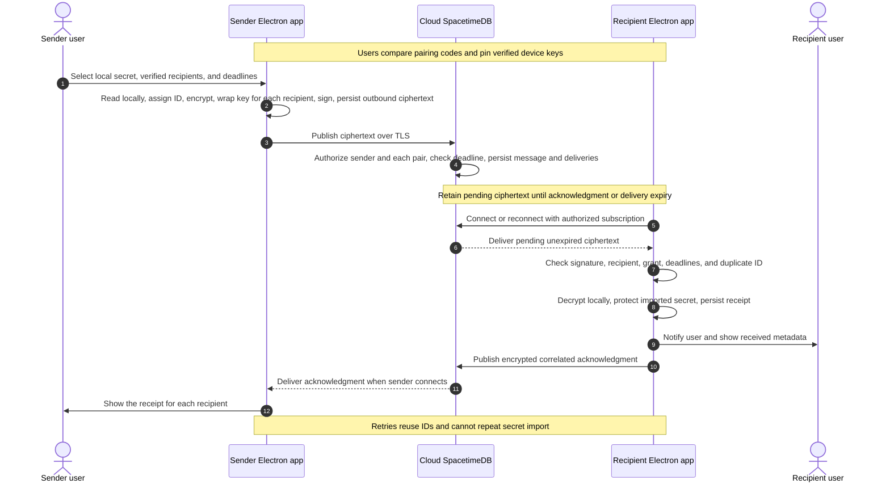

# .sct architecture and implementation order

.sct uses Electron, React, and TypeScript. The Electron main process owns every sensitive operation on a Mac.
These operations include vault access, Keychain, encryption, child processes, sharing, relay connections, and Agent Access.
The sandboxed renderer calls a narrow preload bridge and receives metadata only.
Each Mac keeps its own vault, private keys, cached activity, and pending messages. No local server or separate daemon runs.

## Local runtime injection

The project registry maps a project to its source folder. The vault root resolves `.sct/[project-name]/secrets.sct`.
`sct run` decrypts locally and supplies the child environment before the command starts.
The `@sct/env` SDK receives values through a signed helper's private pipes and updates `process.env`.
The project folder needs no `.env` file, replacement secret file, manifest, symlink, or FIFO. Both paths work offline.
See [runtime injection](runtime-injection.md).

## Agent Access

`sct agent` (CLI) and `sct mcp` (stdio MCP server) run inside the signed executable and share one request path:

1. Identify the caller. .sct finds the first listed agent among the parent processes and checks its code signature.
   An impostor fails before any other check. An unverified caller needs an extra confirmation in the approval window.
2. Check the request against a strict schema. Unknown fields and arbitrary commands fail.
3. Show the local approval window. Each approval applies to one request and one deadline.
4. Run the operation. Return metadata or a fixed outcome. Results contain no secret value and no process log.

Local operations open no relay connection. `relay_status` connects only when an approved request asks for it.
See [Agent Access](agent-access.md).

## AirDrop sharing

The AirDrop sharing flow encrypts selected secrets for one verified device and sends the file through AirDrop.
See [sharing](sharing.md). Relay sharing below is the second transport. The **Relay** tab of **Sharing** uses it.

## Mock Wallet cards

The main process sends fake card fields to walletmcppass.com and downloads the signed pass.
It checks the pass and opens the AirDrop picker for an iPhone. This flow uses no secret, device key, or relay.
See [mock Wallet cards](wallet-cards.md).

## Relay sharing (Phase 2)

Cloud-hosted SpacetimeDB stores ciphertext and minimal routing metadata. See [relay setup](relay.md).
Devices keep pending ciphertext, cached activity, and durable delivery records.

The admin is the user who publishes a secret. Any user can be the admin of a secret that they publish.
An admin can send one secret to one or more paired recipients. The demo shows one recipient.
The admin's app encrypts the secret one time with a new message key.
Then it encrypts the message key separately for each recipient.
SpacetimeDB keeps a separate delivery status for each recipient.

## Phase 2 sharing sequence

A receipt shows durable delivery. It does not show execution.
No step starts a process or needs an agent.

## Relay keys and authorization

Device private keys and relay client tokens stay in macOS Keychain. Relay deployment credentials stay outside Git and desktop builds.

The TypeScript relay module defines authenticated devices, verified pairs, encrypted envelopes, grants, and delivery status.
Issue #11 defines the schema and communication contract.
Issue #16 defines shared transfer and acknowledgment types.
Use shared TypeScript types where the relay and clients require the same contract.

A transfer envelope carries an ID, kind, sender identity and device, recipients, creation time, delivery deadline, ephemeral key, IV, authentication tag, ciphertext, and signature.
A receipt envelope carries the transfer ID as its correlation ID.
Each recipient gets one wrapped message key in its own `delivery` row.
Keep secrets, grant contents, and descriptive secret names inside ciphertext.
Authenticate routing fields with the ciphertext.
Device keys use X25519 for encryption and Ed25519 for signatures.

Use TLS for every relay connection.
Bind each device to an authenticated relay identity.
Both users verify device keys before sharing.
A relay identity alone does not establish trust in a public key.
If a peer key changes, require a new verification.

Check that the claimed sender matches the authenticated caller.
Authorize pair registration, publication, reads, subscriptions, and status changes.
An acknowledgment must come from the expected recipient.
Use private tables with authorized views, or equivalent server enforcement.
Client subscription filters alone do not enforce authorization.
Check delivery deadlines against server time.

## Relay schema

Issue #11 defines this first version of the relay schema.
The relay does not read the encrypted bytes. Issue #16 defines the contents of `payload` and `wrappedKey`.

All tables are private. Clients read data only through the views.

| Table | Columns | Purpose |
|---|---|---|
| `device` | `identity` (primary key), `name`, `encryptionPublicKey`, `signingPublicKey`, `registeredAt` | One row for each app installation |
| `pair` | `id` (primary key), `initiator`, `peer`, `status` (`Pending` or `Verified`) | Two devices that can share secrets |
| `message` | `id` (primary key, set by the sender), `sender`, `payload`, `createdAt`, `deliverBy` | One row for each published transfer |
| `delivery` | `id` (primary key), `messageId`, `recipient`, `wrappedKey`, `status` (`Pending` or `Received`), `receivedAt` | One row for each recipient of a message |
| `receipt` | `deliveryId` (primary key), `receipt` | The encrypted signed receipt of one delivery |
| `expiry_notice` | `id` (primary key), `correlationId`, `sender`, `recipient`, `notice`, `createdAt`, `retainUntil` | One encrypted local-cleanup notice |
| `maintenance` | `id` (primary key), `scheduledAt` | The relay maintenance schedule |

| Reducer | Behavior |
|---|---|
| `registerDevice(name, encryptionPublicKey, signingPublicKey)` | Creates the `device` row of the caller, or changes its name. It rejects changed keys, because paired devices trust the registered keys. A key change needs a new identity and a new pairing. |
| `requestPair(peer)` | Creates a `Pending` pair from the caller to the peer. It rejects the request if either device has no `device` row, the peer is the caller, or the two devices already have a pair. |
| `confirmPair(pairId)` | Sets the pair to `Verified`. Only the peer of the pair can call it. |
| `removePair(pairId)` | Deletes the pair. Either device of the pair can call it, for example after the pairing codes differ. The devices can then pair again. |
| `publishSecret(id, payload, deliverBy, recipients)` | Saves one message and one pending delivery for each recipient. Each recipient must have a `Verified` pair with the caller. The deadline must be in the next 7 days. An exact retry with the same ID succeeds. A changed retry fails. |
| `acknowledge(messageId, receipt)` | Saves the encrypted receipt in `receipt` and marks the caller's delivery as received. A second call keeps the first receipt. |
| `publishExpiryNotice(id, correlationId, recipient, notice)` | Saves one encrypted notice for a verified peer. An exact retry succeeds. |
| `maintainRelay(schedule)` | Deletes expired pending deliveries and records that passed their retention deadline. Only the relay scheduler can call it. |

| View | Rows |
|---|---|
| `my_inbox` | The caller's pending deliveries with ciphertext, wrapped key, sender, and deadlines |
| `my_sent` | The caller's deliveries with recipient, deadline, status, receipt, and receipt time |
| `my_peers` | For each pair of the caller, the pair ID, the pair status, the initiator, and the `device` row of the other device |
| `my_expiry_notices` | Encrypted expiry notices for the caller |

The relay takes `sender` from the authenticated caller. It sets `createdAt` and `receivedAt` from server time.
A delivery row leaves `my_inbox` after `acknowledge`. The recipient app keeps its own local record.
The recipient app protects the secret locally before it calls `acknowledge`.
A third identity sees no rows of another pair.

Issue #11 defines the `pair` table and the pair reducers.
Both users compare the pairing code in the app before they accept the pair. See [relay pairing](relay.md#pairing).
Issue #16 defines the signed encrypted transfer and receipt bytes.
Issue #17 adds delivery deadlines and exact retries that reuse the original ID.
Scheduled relay maintenance removes expired pending deliveries.
The relay retains messages, acknowledgments, and duplicate-delivery records for 30 days after the delivery deadline.
The `acknowledge` reducer stores the encrypted authenticated receipt from issue #16.

## Phase 2 delivery and expiry rules

1. Persist outbound ciphertext locally before publication.
2. Persist accepted ciphertext on the relay before the relay reports a successful publication.
3. Restore authorized subscriptions and pending delivery after reconnect.
4. Retry with bounded backoff and the original message ID.
5. Reject an ID reused with different contents.
6. Check the signature, verified sender, recipient, grant, and deadlines before local import.
7. Protect the received secret locally. Persist the receipt. Then send an acknowledgment.
8. Return existing receipt status for duplicate delivery without another secret import.
9. Persist acknowledgments for offline senders.
10. Retain duplicate-delivery records through the replay window.

Give transfers, acknowledgments, and status replies explicit retention deadlines.
Never retry expired ciphertext under a new ID without a new user submission.
The relay sharing UI (#14) distinguishes queued, sent, received, failed, and expired states.

Delivery expiry blocks later import of that message.
It cannot revoke credentials already delivered.
Grant expiry separately blocks new local access.
Received injection-only grants deny reveal, copy, and reshare from the time of import.
These restrictions belong to Phase 2 and do not depend on agent approval.

Check grant expiry before import and access, at startup, after resume, and during scheduled cleanup.
Delete expired recipient Keychain entries and the applicable encrypted files.
Persist cleanup outcomes and queue an encrypted expiry notification for the sender.
Cleanup cannot run while the app does not run or the Mac sleeps.
Cleanup must finish before new access after startup or resume.
External copies can retain delivered credentials.

## Offline behavior

Local vault operations remain available during relay outages.
Persist pending transfers, replies, grant deadlines, delivery records, and cached activity locally.
The UI shows cached status separately from remote status that the relay reported.
Cross-device delivery and acknowledgments require the relay.
Local expiry checks do not depend on a live subscription.

## Integration of sharing and Agent Access

Issue #33 starts after secure sharing in #20 and local Agent Access in #10 pass.
It extends #16 envelopes and #17 delivery for encrypted task requests, refusals, and execution results.
The standalone local request contracts remain independent of relay identities and wire envelopes.

Require local recipient approval tied to the task, grant, recipient, and message ID.
Check the permitted operation, the active grant, and the deadline immediately before the start.
A relay message or agent cannot approve its own execution.
Reject arbitrary commands and reused approval responses.
Use again the approved local start path from #8 and the runtime injection from #32.

Persist an execution claim before the start.
Persist outcomes and encrypted, signed, correlated replies for offline senders.
Return approved, redacted results only.
Keep secrets, task contents, and execution output inside ciphertext.
Do not relay unrestricted agent logs.

Durable execution records prevent duplicate delivery from automatically repeating execution.
After a crash, a claim without a durable outcome needs local review before another start.
Retain execution records through the replay window.
Do not promise exactly-once execution of arbitrary process side effects.
An expired grant blocks new starts. It cannot delete credentials from a process that runs already.

Keep receipt distinct from awaiting approval, running, completed, refused, expired, and uncertain execution.
Local Agent Access stays usable without the relay. Sharing stays usable without an agent.

### Remote demo tasks

The sender of a relay transfer can ask its recipient to run the fixed environment demo with that grant.
The task can start no other program. It contains no command, approval, or secret value.

1. The sender selects a sent transfer that the recipient imported. The desktop UI or the `request_remote_demo` agent operation submits the task.
2. The sender app seals a `task` envelope and publishes it through `publishSecret`. The approval deadline is 24 hours.
3. The recipient app opens the task and checks the sender, the recipient, the grant, and the deadlines.
   It saves the task record. Then it sends a delivery receipt through `acknowledge`.
4. The recipient user approves or refuses the task in the **Relay** tab. The decision contains the task digest, so it applies to one exact task.
5. Before the start, the app runs grant cleanup and checks the grant and the deadline again. Then it saves the execution claim.
6. The app starts the fixed demo with only the secrets of that grant in the child environment.
7. The app saves the outcome. Then it seals a `result` envelope and publishes it with one fixed ID. Retries reuse that ID.
8. The sender app opens the result, checks that it answers a task that it sent to that device, and sends a delivery receipt.

The relay stores tasks and results in the same tables as transfers. It cannot read the kind of contents or the contents.
A result contains the outcome, the exit code, whether `SCT_DEMO_TOKEN` was present, and the finish time. It contains no process output.
A task that names no imported grant from its sender is refused without user action. A task after a deadline expires.

A claim without an outcome after a restart becomes `uncertain`. The task does not run again.
The user must review it before .sct sends the uncertain result and before .sct starts another run.
The sender must submit a new task to run the demo again.

Only the desktop app writes relay files and runs tasks. An agent session opens a passive relay.
The passive relay reads the relay rows and the local files. It publishes nothing and acknowledges nothing.
`request_remote_demo` writes one encrypted request file. The desktop app moves the request into its outbox and deletes the file.

## Implementation order

Complete local runtime injection before relay setup. Then develop the relay and local Agent Access independently.
Only #33 combines both. A ticket starts when its prerequisites pass. GitHub issue IDs stay unchanged.

### Local foundation

| Order | Issue | Work | Prerequisites | State |
|---|---|---|---|---|
| 1.1 | [#24](https://github.com/omavashia2005/.sct/issues/24) | Bootstrap the Electron, React, and TypeScript app | None | Done |
| 1.2 | [#1](https://github.com/omavashia2005/.sct/issues/1) | Create a stable Electron app signing identity | #24 | Done |
| 1.3 | [#25](https://github.com/omavashia2005/.sct/issues/25) | Build the basic Secrets screen | #24 | Done |
| 1.4 | [#26](https://github.com/omavashia2005/.sct/issues/26) | Connect the Secrets screen to macOS Keychain | #24, #1, #25 | Done |
| 1.5 | [#2](https://github.com/omavashia2005/.sct/issues/2) | Test Keychain access after Electron rebuild | #1, #26 | Done |
| 1.6 | [#6](https://github.com/omavashia2005/.sct/issues/6) | Check the local vault operations for sharing | #2, #26 | Done |
| 1.7 | [#32](https://github.com/omavashia2005/.sct/issues/32) | Inject project secrets at runtime without .env files | #6, #26 | Done |

### Relay setup and contracts

| Order | Issue | Work | Prerequisites | State |
|---|---|---|---|---|
| 2.1.1 | [#3](https://github.com/omavashia2005/.sct/issues/3) | Set up the cloud-hosted SpacetimeDB relay | #32 | Done |
| 2.1.2 | [#11](https://github.com/omavashia2005/.sct/issues/11) | Define the relay schema and communication contract | #3 | Done |
| 2.1.3 | [#12](https://github.com/omavashia2005/.sct/issues/12) | Connect Electron storage to the SpacetimeDB relay | #6, #11 | Done |
| 2.1.4 | [#15](https://github.com/omavashia2005/.sct/issues/15) | Verify pairing and bind device keys to relay identities | #6, #11, #12 | Done |
| 2.1.5 | [#16](https://github.com/omavashia2005/.sct/issues/16) | Define encrypted secret transfer and acknowledgment envelopes | #11, #15 | Done |
| 2.1.6 | [#13](https://github.com/omavashia2005/.sct/issues/13) | Secure the sharing operations across the Electron boundary | #12 | Done |

### Sharing UI, delivery, and security checks

| Order | Issue | Work | Prerequisites | State |
|---|---|---|---|---|
| 2.2.1 | [#14](https://github.com/omavashia2005/.sct/issues/14) | Build the secret sharing and delivery activity UI | #13, #15, #16 | Done |
| 2.2.2 | [#17](https://github.com/omavashia2005/.sct/issues/17) | Deliver secrets and acknowledgments through SpacetimeDB | #3, #11, #12, #15, #16, #13, #14 | Done |
| 2.2.3 | [#19](https://github.com/omavashia2005/.sct/issues/19) | Handle sharing expiry, local cleanup, and retry deadlines | #17 | Done |
| 2.2.4 | [#20](https://github.com/omavashia2005/.sct/issues/20) | Check secure secret sharing on two devices | #17, #19 | Done |

Build the #14 UI together with #17 delivery so that users can test transfers from both app windows. #14 does not depend on #17.

### Local Agent Access

| Order | Issue | Work | Prerequisites | State |
|---|---|---|---|---|
| 3.1 | [#5](https://github.com/omavashia2005/.sct/issues/5) | Add the TypeScript agent CLI, MCP entrypoint, and demo build commands | #32, #24, #1 | Done |
| 3.2 | [#7](https://github.com/omavashia2005/.sct/issues/7) | Define local agent requests and the authenticated request channel | #5, #6, #32 | Done |
| 3.3 | [#4](https://github.com/omavashia2005/.sct/issues/4) | Check Claude Code MCP approval | #5, #24 | Done |
| 3.4 | [#18](https://github.com/omavashia2005/.sct/issues/18) | Enforce local project access and agent approval | #7, #32 | Done |
| 3.5 | [#8](https://github.com/omavashia2005/.sct/issues/8) | Launch approved local agents with project environment injection | #7, #18, #32 | Done |
| 3.6 | [#9](https://github.com/omavashia2005/.sct/issues/9) | Implement the narrow MCP interface | #4, #8 | Done |
| 3.7 | [#10](https://github.com/omavashia2005/.sct/issues/10) | Connect Claude Code and check local Agent Access | #9, #24 | Done |

These issues have no direct or indirect relay dependency.

### Integration

| Order | Issue | Work | Prerequisites | State |
|---|---|---|---|---|
| 3.8 | [#33](https://github.com/omavashia2005/.sct/issues/33) | Integrate local Agent Access with encrypted relay sharing | #20, #10, #16, #17, #19 | Open |

### Post-MVP

| Order | Issue | Work | Prerequisites | State |
|---|---|---|---|---|
| 4.1 | [#22](https://github.com/omavashia2005/.sct/issues/22) | Add AirDrop transport for encrypted handoffs | #20, #15, #16, #18 | Open |
| 4.2 | [#23](https://github.com/omavashia2005/.sct/issues/23) | Add Factory integration through the narrow MCP interface | #10, #9, #18 | Open |
| 4.3 | [#40](https://github.com/omavashia2005/.sct/issues/40) | Create experimental Wallet cards and share them through AirDrop | #24 | Built. The iPhone test is open. |

Issue #30 was workflow maintenance. Issue #21 stays closed, because demo rehearsal is outside development scope.

## Reference documentation

SpacetimeDB supports TypeScript modules and clients.
Its access controls distinguish public tables, private tables, and authorized views.
Consult the [module documentation](https://spacetimedb.com/docs/databases/), [tables](https://spacetimedb.com/docs/tables/), and [views](https://spacetimedb.com/docs/functions/views/) during implementation.
