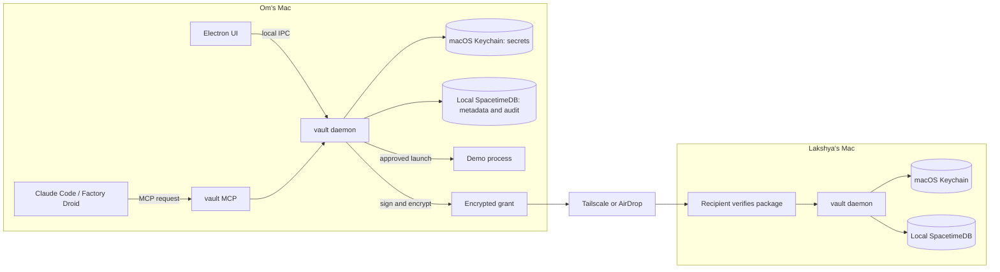
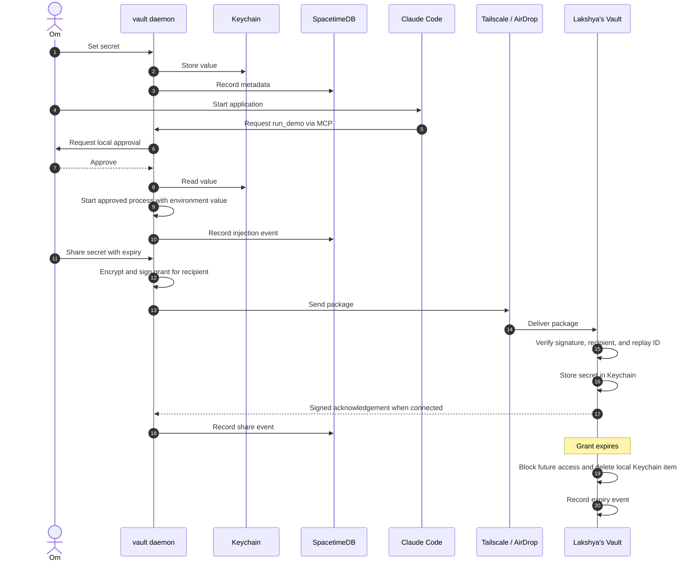

# Vault MVP: Architecture, sequence, and dependency order

## Architecture

## Sequence

## Topological order

Issues can run in parallel only after all dependencies are met.

| Phase | @omavashia2005 | @LakshyaDhingra |
|---|---|---|
| Setup | #1 signing identity, #4 MCP approval | #3 local SpacetimeDB |
| Core | #2 Keychain rebuild, #5 workspace, #6 Keychain, #7 core API | #11 database schema, #12 daemon |
| Runtime | #8 injection, #9 MCP, #10 Claude | #13 Electron, #14 UI |
| Sharing | #16 encrypted grants, #18 access controls | #15 pairing, #17 Tailscale |
| Completion | #24 Droid, #22 submission | #19 expiry, #23 AirDrop, #20 security, #21 demo |

### Dependency edges

- #1 → #2 → #5 → #6 → #7 → #8 → #9 → #10.
- #4 → #9 → #24.
- #3 → #11 → #12 → #13 → #14 → #15 → #16 → #17.
- #6 → #12 and #15. #7 also needs #11.
- #8 and #16 → #18.
- #12 and #16 → #17.
- #17 and #18 → #19.
- #15 and #16 → #23.
- #10 and #19 → #20.
- #10, #14, #17, and #19 → #21 → #22.

Treat these edges as authoritative when phases overlap. Do not start an issue until its predecessors pass their acceptance checks.

## Security constraints

Only Keychain stores plaintext secret values at rest. SpacetimeDB and the UI store metadata only. Approved child processes receive credentials and can read them. Vault cannot prevent arbitrary child processes from copying credentials. Expiry prevents new Vault access but cannot revoke copied credentials at an external service.

All issues with `priority:mvp` are required before post-MVP work. Other sponsor tracks remain deferred. See [Technical glossary](https://github.com/omavashia2005/calhacks-kuber/blob/main/docs/glossary.md).
